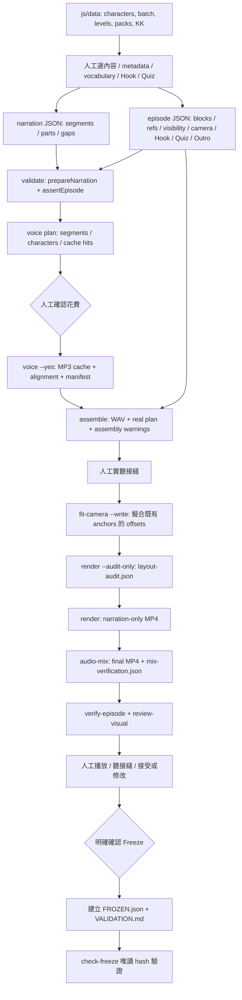

# Video Studio 架構分析與分期

Milestone 2B 已實作，最新狀態以 [MILESTONE-2B.md](MILESTONE-2B.md) 與 README 為準（2A：[MILESTONE-2A.md](MILESTONE-2A.md)）。下文保留 M1 初始分析 / 長期提案；尤其 2A **只在 Studio isolated workspace 寫 production schema drafts**，沒有 promotion 到 canonical scripts/video，也沒有付費或 render。

依據：`AGENTS.md`、`docs/video/CURRENT_STATE.md`（P5 freeze 後）、`docs/video-design-system.md` 現行章節、現行 CLI 與 voice README。保留 `p5-validation` branch；既有 untracked 中間檔不搬動、不納入。Repo 無 package.json；不建立 root package manager 或改使用者 App。

## 現行 dependency flow

Render 預設已自動混音；wrapper 可選 `--narration-only` 後獨立 mix，以呈現各步 status，不能重複混音。`verify-episode --video` 依 canonical 流程驗證 narration-only；final mix 另由 audio-mix 檢查。不要用 legacy make-video init。

## 可直接 reuse 與 gaps

| 步驟 | 現有能力 | Automation gap / adapter |
|---|---|---|
| Discover | browser-owned `js/data` scripts | 新唯讀 adapter 按 App 載入順序執行於隔離 VM；已完成 |
| Metadata | explicit series / episode / level validator | 建議與人工確認分開；canonical legacy mapping 支援 TOEFL 下一集建議；已完成 |
| Hook / Quiz | scene_contrast / number_contrast；meaning | 候選 provider、人工選擇保存；M1 原文擷取，未接 AI；已完成基本版 |
| Prepare | 目前人寫兩份 JSON | compiler 必須建立穩定 line/block/note IDs、形式映射、標點 handoff、整句一次 TTS、visibility / camera anchors；未完成 |
| Validate | segments prepare、episode-refs assert | 在新 wrapper import 既有 pure functions，輸出 JSON validation results |
| Voice plan | `planNarration` 已提供 counts / charsToGenerate / segments | 直接呼叫函式，勿解析 formatPlan stdout；hash plan 與 draft revision 綁定 |
| Generate | `voice.mjs --yes`，cache、max-chars、失敗可續跑 | 僅單獨 confirmation endpoint；一次性 token 綁 plan hash / revision / max chars，変更即失效 |
| Assemble | WAV、plan、assembly.json warnings | CLI adapter + report reader；保留人工聽接縫 gate |
| Camera fit | 依真實 plan 擬合 offset、JSON stdout | 不能從零建立 anchors；compiler 先提供 anchors；只寫新 episode |
| Layout audit | 全幀 audit，JSON issues，失敗 throw | 不只檢查 exit code，還需 report schema / issues=0 |
| Render | Playwright + ffmpeg，固定本機 port | serialized runner 避免多 job port 衝突；可恢復 logs / artifacts |
| Audio mix | 本機 mix + 六項驗證 report | report checks 全通過才進下一步 |
| Verify | verification.json、MP4 解碼、畫面 / timing 驗證 | 檢查全 PASS；報告寫到新 job output 目錄 |
| Review visual | stdout camera / viewport evidence | wrapper 先保留 stdout evidence，後續獨立 adapter 正規化；warning 不可自動接受 |
| Freeze | check-freeze 只驗證，沒有通用 freeze writer | 新 writer 產生 hash / validation 記錄；人工 preview 確認才 exclusive-create；不自動 git |

## 新架構與 source of truth

`video-studio/` 是 production wrapper 與 UI 的邊界，不修改 `scripts/video/`。

M1：`catalog.mjs`（唯讀 source adapter）、`store.mjs`（revision / atomic draft saves / validation）、`server.mjs`（HTTP API / loopback / allowlist）、`public/`（buildless responsive UI）、Windows launcher、tests、說明文件、`state/` local ignore。

Draft schema v1：`schemaVersion, id(uuid), contentId, sourceHash, revision, status, createdAt, updatedAt, decisions{series,seriesEpisode,level,vocabulary[keys],hook{candidateId,type,text},quiz{candidateId,...confirmedCandidate}}, steps[], artifacts{}, approvals{}`。部分選擇可存 `draft`；全部明確選擇後為 `configured`。M1 status 僅表示編輯完成，不保證 production-ready。

SourceHash 綁定原文、作者、詞彙（含 levels / examples / KK）。UI 顯示來源，沒有修改 js/data 的 API。Quiz snapshot 是該次人工確認的決策證據，不是另一份可修改的詞彙庫。Hook 文案是人工決策。ContentID 不變；修改文章請另建 draft。來源 drift / revision 衝突拒絕保存。

M2 compile 後 canonical video data 仍是 `scripts/video/narration/<contentId>.json` 與 `episodes/<contentId>-auto.json`，不是 UI copy。Job 只存 source hashes、revision、artifact paths / hashes、step evidence。單一 compiler 從確認決策產生兩份 canonical JSON；之後 UI 編輯走 compiler 新 revision，取消舊 plan / approval，避免兩份自由編輯資料。已有 canonical episode 或 FROZEN / target assets 時拒絕建立，不覆寫；重做命名需另行設計與確認。

預計 job milestones：`draft → configured → prepared → validated → voice_planned → voice_generated → assembled → audited → rendered → mixed → verified → approved → frozen`。Camera fit 與 visual review 分別記 steps，另設 `awaiting_seam_review`。每一步保存 `{name,status:pending|running|succeeded|failed|awaiting_confirmation,startedAt,finishedAt,inputHash,result,errors,warnings,logPath}`，失敗立即停止。重啟時 running 標記 interrupted，只有輸入與 artifact hash 仍相符才可續跑；不能依 UI progress 推定成功。Needs changes 產生新的 draft revision、作廢 downstream approval。accept 與 freeze 分開，freeze 請求再次確認當前 artifact hash 與人工 warning acknowledgement。

M2 預計新增：`compiler.mjs`、`production/runner.mjs`、`production/adapters.mjs`、`production/guards.mjs`、`production/voice-plan.mjs`、confirmation / review APIs、compiler/runner tests；M3 新增 MP4 streaming（Range）、review UI、freeze writer / preview。未實作的 routes 不暴露，尤其不設一個可由 UI 傳任意 command 或 path 的 endpoint。

## Frozen / shared template 與 technical debt

M1 沒有改 shared template、voice、render、verify、ReadingCue、canonical rules 或任何 frozen assets。P2/P3/P4/P5 check-freeze before/after 都須 intact；沒有 rerender references，沒有付費，沒有 commit / push / tag / merge。

後續 wrapper 如果只新增 adapter / compiler，不改既有共用程式，同樣不需要 template revision。Frozen protection 需按所有 FROZEN hash paths 建 denylist，不可只用四個 content IDs；寫 canonical、assemble output、camera --write、render output、freeze 都先檢查，exclusive-create 避免覆寫。既有工具含 overwrite 行為，因此不可直接讓 browser 指定工具參數。

| 技術債 | M1 | 後續判斷 |
|---|---|---|
| 無中文 Hook | 不阻礙 draft | 開始 compile 前決定正式支援是否必須；需 shared validator revision 時停下說明並請使用者決定，不能複製空白 workaround |
| Outro mascot default | 不阻礙 | 根據新 episode duration 算明確 cueDuration，可維持 episode-level；不複製 P5 固定 1.5，也不更改 shared default |
| P5 visual warnings | 不阻礙 | 已人工接受，只保留凍結；新 episode warning 另行審查 |
| 本機 paths | M1 僅 Node、repo-relative | M2 preflight 檢查已有 env overrides；跨機器 deployment 才考慮修 fallback |
| LF / CRLF | 新檔不更動舊檔 | 不批次 normalize、不新增影響 frozen hash 的 attributes；跨機器 freeze portability 另案 |

## Phases / acceptance

1. **M1（本輪）**：真實 content、metadata 建議、vocab / Hook / Quiz 人工選擇、保存 / 重新開啟恢復。無 production JSON、付費、P6。
2. **M2**：新 wrapper compiler + validate + 免費 voice plan，machine-readable status / cost、持久 job、read-only preflight / frozen guard；再接獨立付費 confirmation 與已有 pipeline、接縫聽取確認、失敗恢復。無中文 Hook 如需 shared 修改，在此先停下請使用者決定。
3. **M3**：MP4 preview、accept / needs changes、人工 freeze preview / confirmation、手機安全存取；完成後由使用者選 P6 全部明確資料，首次 UI end-to-end。需人工 JSON / 零散 commands 即 automation gap，修 Studio 而非手改 P6。

第一輪不需要使用者決定 P6；接 M2 前需討論 Hook 無中文 schema 路徑及候選品質（原文擷取或 AI provider），不能偷偷改 production rules。
