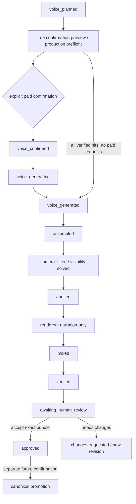

# ADR-VS-2B：付費確認、隔離 candidate 與人工驗收

Status: **Proposed — design only**。
Date: 2026-10-12。Decider: repository owner。

本文件提出 contracts，不代表任何 capability 已開通。2A / 2A.1 implementation
仍只到 voice_planned，productionReady=false。本輪沒有程式碼、付費、render、
P6、promotion、freeze 或 Git publishing 操作。Canonical production rules 沒有改變。

依據：AGENTS.md、CURRENT_STATE.md、video-design-system.md 現行章節、
ARCHITECTURE.md、MILESTONE-2A.md、REVIEW-M1-2A.md、MILESTONE-2A.1.md。
R1–R5 已修復；這份設計延伸其 freshness / full decision evidence contracts。

## 1. 決策與可重用 interfaces

維持唯一 production truth：human decision snapshot → pure compiler → 現行
narration / episode schema。Run database、receipt、reports、bundle manifest 是
execution evidence，不是第二套 episode schema；禁止 UI 編輯 artifacts 或狀態。

採 immutable revision inputs + isolated candidate + durable coordinator。
付費 authorization 只在一個 executor 生效，幾何來自真實 renderer，機器驗證
與人工接受分開。Canonical promotion 是另外一個明確授權操作，不接入自動
production chain；freeze / commit / push / tag 不屬於 2B。

| 現行 interface（本輪只讀） | 2B reuse / 限制 |
|---|---|
| voice/segments.mjs: prepareNarration, layoutParts | 唯一 segment / role / cache key / playback order / parts contract；whole sentence 只送一次 TTS |
| voice/generate.mjs: planNarration | 免費確認 envelope 的 segment classification / chars 仍由它產生；Studio 補 cache integrity evidence |
| voice/generate.mjs: generateNarration | 注入 guarded synthesize / cache / manifestPath；不使用無約束 CLI paid invocation |
| voice/elevenlabs.mjs: buildRequest, synthesizeWithTimestamps | 唯一 request construction / HTTP client；利用 fetchImpl 邊界保存 request / response evidence，不重寫 TTS |
| voice/cache.mjs: createCache({audioDir,alignmentDir}) | 只指 candidate-owned directories；原 has 只檢查存在、write 可替換，需外層 integrity / exclusive publication guard |
| voice/assemble.mjs: assembleNarration | 顯式 prepared / isolated cache；原 alignment / splitSentence / cut / provenance 邏輯不另寫 |
| assemble.mjs | 可於 candidate root 使用原 CLI；只有 --out 無法隔離 cache，因此不可在真實 repo root 直接呼叫 |
| render-lib.mjs / post-reference.html / reference/PostTemplate.js | 在 candidate pipeline 副本載入原 template；window.template.time、renderFrame、audit 為 renderer truth |
| fit-camera.mjs | 只替已有 anchors 擬合 offset，使用不同 word normalization；限定 supported subset 作初值，不當 solver 或 final approval |
| render-episode.mjs | 原 --audit-only 全 30fps frames；正式 render 強制 --narration-only，隔離 --docs / --out |
| audio-mix.mjs: mixAudio, verifyMix / CLI | 一次 mix + 原六項檢查；禁止 --no-verify |
| verify-episode.mjs | narration-only MP4 + 原 verification.json 全 checks PASS，外加 final MP4 binding / decode / mix evidence |
| review-visual.mjs | 固定 ports、stdout、note 每 0.1s 採樣、--shots 帶特定 episode refs；保留 diagnostic evidence，不視為通用 full-frame gate |

原 generator withRetry 預設最多三次 retries（alignment 可 retry 一次），maxChars
只限制初始 misses sum，manifest 沒有每次 request 的計費／未知 outcome evidence。
因此直接包 voice CLI 或只加 UI confirmation 不符合此設計。

### Alternatives / trade-offs

| 方案 | 優點 | 拒絕／採用理由 |
|---|---|---|
| 真實 root 呼叫既有 CLI，只換 --out | 最少 adapter | 拒絕：輸入／cache／alignment／serve root 仍可能寫 canonical |
| 重寫 TTS、renderer 或 episode format | 可完全控制 interface | 拒絕：造成第二套 production truth，扩大 regression scope |
| Hash-pinned candidate root + 現行 functions / CLI | 保留已驗證 schema 與 renderer，writes 可隔離 | **採用**；需 coordinator、workspace builder、request ledger、geometry wrapper |
| JSON files + expiring lockfiles 管理 paid jobs | 延伸 2A 容易 | 拒絕：跨 process CAS、budget reservation、crash recovery 不足 |
| Local transactional run DB + OS lifetime lock | durable transitions、unique receipts／attempts | **採用**；增加 local storage adapter；不能以 DB transaction 冒充外部 API exactly-once |

## 2. 執行識別、workspace 與 evidence

三個不同 identity：draftId/revision（人的決策）、runId（執行）、candidateId
（該次 production attempt 的 UUID，非 contentId）。ContentId 與 narration.id /
episode.id 維持原慣例，不為隔離而任意改 production IDs。

每個 run 固定 source snapshot、confirmed decisions、compile outputs、shared code /
assets / voices hashes、工具版本與 environment fingerprint。Revision inputs immutable；
step outputs 以 attempt dirs exclusive-create，成功後 seal。不能讓 fit-camera --write
覆寫 sealed compile episode；只允許寫本 step 的 private working copy，產出新的
episode derivative 與 parent hashes。這是同一 production artifact 的版本鏈，
不是兩份可各自人工編輯的 canonical data。

```text
video-studio/state/
  coordinator.db                     # proposal: local SQLite, transactions / FULL durability
  drafts/<draftId>.json               # 2A decisions；mutable via revision-CAS API
  revisions/<draftId>/r<N>/inputs/    # source / decisions / narration / episode snapshots
  receipts/<receiptId>.json           # immutable receipt content; mutable status lives in DB
  runs/<runId>/attempts/<step>/<uuid>/ # logs, result, staging outputs, completion manifest
  candidates/<candidateId>/root/
    scripts/video/...                 # allowlisted, byte-identical pipeline dependency closure
    scripts/video/narration/<contentId>.json
    scripts/video/narration/<contentId>.manifest.json
    scripts/video/narration/alignment/<segmentHash>.json
    scripts/video/episodes/<contentId>-auto.json
    docs/<contentId>-auto/{narration.wav,<contentId>-auto.plan.json,assembly.json,...}
    outputs/{narration-only.mp4,final.mp4}
    voice-cache/<segmentHash>.mp3
  candidates/<candidateId>/bundle.json
```

Candidate root 是 step-specific materialized working root；sealed attempt outputs
另存 immutable artifact store。下一步由 hash-verified predecessor materialize，
最後 seal bundle。不得把正在被工具改寫的 root 視為 immutable bundle。
Pipeline closure 含原 HTML、JS、CSS、Mascot、voices、series、audio assets，保留
relative imports；copy bytes 不 normalize LF/CRLF，不用 writable hardlinks 或 junction。
不複製 .env、repo .git、frozen episode assets 或無關檔案。REPO_ROOT 會由副本
voice/config.mjs 的位置自然指向 candidate root。原 root cache 僅可驗證後讀取／copy。

DB 專管 runs / steps / receipts / request attempts / review / publication journal；
draft JSON 仍是 decision authority，DB 只記 decision hash/revision 與 immutable
snapshot refs。Snapshot 與 DB 無跨檔 atomic transaction：先 exclusive-write / flush
snapshot，再 transaction CAS draft revision，記 committed input manifest；孤兒未
committed snapshots 不可執行。Worker success 僅 attach result refs，不整份覆寫 draft。

既有 draft mutation 也必須走同一 coordinator lock：先持久記 mutation intent 並
撤銷舊 run 的 dispatch rights，再 atomic-save 新 draft revision，最後記 committed
revision。Crash 在中間則 mutation_pending，所有 paid transitions BLOCK，恢復時
比較舊／新 decision hashes 才 finalize；不能讓 draft JSON 更新後 DB 舊 receipt 仍
可 dispatch。這是未來 Studio store adapter 的修改範圍，不修改 shared pipeline。

Hash contract：artifact SHA256 exact bytes + length；JSON semantic hash 使用固定版本
canonical serialization，與 bytes hash 分別命名，不混用。Existing segment hash
完全 reuse prepareNarration，不自行重算 voice keys。Evidence includes hash algorithm /
format version；manifest refs 都是 relative allowlisted paths，reject path traversal、
case-fold collisions、ADS、reserved names、symlink/reparse point 與 escaping realpaths。

每步標準 result：

```json
{
  "schemaVersion": 1, "runId": "...", "candidateId": "...", "revision": 7,
  "step": "assemble", "attemptId": "...", "status": "succeeded",
  "inputManifestHash": "sha256:...", "engineManifestHash": "sha256:...",
  "startedAt": "...", "finishedAt": "...", "fencingToken": 12,
  "outputs": [{"role":"plan","path":"...","bytesHash":"...","size":123}],
  "errors": [], "warnings": [], "unresolved": [],
  "logRefs": [], "exitCode": 0, "productionReady": false
}
```

Missing report、wrong schema、partial file 或 exit 0 但 report FAIL 都是 failed。
Durable completion manifest + hashes 才能 commit succeeded；stdout 是 log，不是 state。

## 3. Paid voice confirmation receipt

### 3.1 Confirmation envelope（免費產生）

2A display plan 不含完整 speak/settings，cache hit 也未驗證。因此先建立新的
**free confirmation envelope**：fresh source/revision/Quiz evidence → validation →
prepareNarration → validated/pinned cache → planNarration → buildRequest dry run。
不重新估算 segments；counts / initial chars 來自 current planner，request body
來自 current buildRequest。無法 decode cache / validate alignment / metadata match
則 quarantine candidate copy，視為 miss，重新顯示成本，不能沿用原 hit 數字。

對每個 unique non-silent segment 記錄：segment hash、IDs / parts、speak exact text、
voiceId/name、model、settings、language、prosody previous/next text、outputFormat、
allowlisted API endpoint、serialized body hash、body.text.length。Hash 固定已解析
defaults 與 voices config，禁止執行時再採 ambient config。
每個 pinned hit 記 audio/alignment byte hashes、decode/alignment report。Cache miss
集合與 duplicate mapping 明列。全部 hit 時直接以 free cache validation evidence
完成 voice_generated，不要顯示會扣費的確認按鈕，也不用假造 paid receipt。

Receipt proposed fields：

```json
{
  "version": 1, "receiptId": "uuid", "runId": "uuid", "candidateId": "uuid",
  "draftId": "uuid", "revision": 7, "sourceHash": "...", "decisionHash": "...",
  "narrationBytesHash": "...", "compiledEpisodeBytesHash": "...",
  "validationHash": "...", "voicePlanHash": "...", "confirmationEnvelopeHash": "...",
  "engineManifestHash": "...", "voiceConfigHash": "...",
  "requests": [{"segmentHash":"...","requestBodyHash":"...","voiceId":"...",
    "model":"...","settings":{},"outputFormat":"...","chars":120}],
  "pinnedCacheManifestHash": "...", "confirmedMissHashes": ["..."],
  "estimatedUniqueTextChars": 120,
  "budget": {"unit":"utf16_request_text","maxSubmittedChars":120,"maxRequests":1,
    "maxCharsPerRequest":1000},
  "retryPolicy": {"version":1,"additionalPaidAttemptsPerHash":0,
    "unknownOutcome":"stop_and_reconfirm","alignmentFailure":"reuse_response_or_stop"},
  "confirmedAt": "...", "expiresAt": "...", "actorId": "local-owner",
  "confirmationChallengeHash": "...", "receiptHash": "..."
}
```

Numbers above are illustrative, not defaults. Budget initial max = exact displayed
unique-miss chars; default additional paid attempts **zero**. Challenge expiry proposal
15 minutes, receipt expiry applies to starting/resuming paid attempts, not discarding
already generated audio. A later policy permitting retry must explicitly display
maximum attempts and attempt-weighted budget; never inherit generator default silently。

UI 顯示 exact spoken text、speaker/model/settings、parts、verified hits/misses、
unique characters、最大 request characters、maximum attempts、remaining budget、
已有 paid/unknown attempts。表單 budget 只能在確認前修改；server 重建並重新顯示。
確認文字「確認產生語音：本次最多提交 N characters／M requests，不自動付費重試」。

這個 characters cap 是 **client request text UTF-16 長度**，不是保證 provider
實際扣額或金額。現行 client 回傳 characters=text.length，沒有權威 billing record；
normalized text、模型計價與失敗 requests 是否扣費仍需實作前查官方 billing contract。
UI 需明示估算單位；若要求嚴格貨幣／credits 上限，缺可靠 provider evidence 時
BLOCK 此模式，不能把本地 sum 宣稱成扣費上限。

### 3.2 一次性消耗與 idempotency

Proposed routes（本輪不建立）：

- POST `/runs/:id/voice-confirmation-preview`：fresh preflight，免費 envelope + challenge。
- POST `/runs/:id/voice-confirmations`：owner identity、CSRF/Origin/Host、idempotency key、
  challenge hash/revision；transaction 一次確認即消耗 receipt 啟動權並綁唯一 executionId，
  enqueue durable run。重複相同 key/body 回同 receipt/job；不同 body 同 key → 409。
- GET `/runs/:id` / events：server effective status，不相信 UI 勾選或 persisted true。
- POST `/runs/:id/resume`：只續同 execution 的合法 residual work，不能取得新 paid rights。

Receipt immutable content 與 DB 狀態 `issued/claimed/expired/revoked/completed` 分開。
Unique constraints: challenge consumption、receipt→execution、execution+hash+attempt。
Double click、API retry、兩個 browser windows 都回同一 execution，不建立第二份授權。
不提供 generic workflow(action=paid) 或 client command/path/settings injection。
只有付費 worker 在成功 claim 後可取得 credentials；server render/mix child env
移除 ELEVENLABS_API_KEY。不將 key寫 candidate／receipt／log，不依 candidate .env。

### 3.3 Per-request hard boundary / budget ledger

唯一 guarded synthesize 在每次 HTTP dispatch 前：

1. 取得同 execution / segment 的 durable lock，驗 receipt current、expiry、revision /
   source／Quiz／artifact／engine evidence，確認 job 未 superseded。
2. 使用 buildRequest 重建 exact URL/body；與 confirmed requestBodyHash、voice settings、
   model、speak、characters **完全一致**。增加文字、改 model、未知 segment、過限即 BLOCK。
3. Transaction reserve chars/request attempt，持久記 `dispatch_intent` 與 fencing token；
   `submitted + reserved + unknown <= confirmed cap`，unknown 永遠佔用預算、不自動退款。
4. durable intent 後才送 HTTP；fetchImpl adapter 先保存 raw response evidence（redacted
   headers/request ID、body digest、必要的 audio/alignment），再讓原 client parse。
5. 完整 validated MP3+alignment seal 後 attach artifacts / mark succeeded。外部 API
   response 與本地 transaction 不原子：crash 落在空窗必須標 unknown，不假設未扣費。

Default retry implementation：仍呼叫現行 generateNarration，但 guarded callback 對
HTTP/network/parse/alignment failure 不給新的 network dispatch。其內部 withRetry
再進 callback 時，若已有 durable response 只能 replay 同一 response；若無 usable
response 就投出不可 retry 的 Studio authorization error。Alignment validation
在 callback 外拋 AlignmentError 時，第二次 callback 同樣只能 replay response／拒絕。
不能僅依 e.retryable 決定再次付費。Offline tests 必須證明 NO_ALIGNMENT、timeout、
429、5xx 與 malformed response 不暗中產生第二個 paid request。

Resume 使用原 prepareNarration + planNarration 對 sealed candidate cache 得到 residual
projection，證明所有 residual misses 屬於原 confirmedMissHashes、body hash 不變。
此 projection 是原 immutable authorization 的 execution subset，不是新的授權 plan。
不能原樣重跑原 miss statuses（generator 不會先重新 cache.has 就略過 miss）。
已成功 hashes 不再 dispatch；未開始且預算仍足夠者可繼續；unknown attempt 必須停止。
新 receipt 需使用者明確看到「可能已扣額、重送可能再次扣額」及新 budget，不能把
同一舊 receipt 當一次性 token 再消耗。Provider history recovery 若未建立可靠 interface
不列為自動 resume 能力；不假設 provider 支援 idempotency key 或 exactly-once。

### 3.4 Freshness、cache changes、restart

| 事件 | Contract |
|---|---|
| source / decisions / Quiz / compiled narration or episode / config / engine 改变 | mutation transaction revoke receipt + supersede run；下一 dispatch／commit 再 freshness check；外部 disk drift 在每次 authoritative read、dispatch、commit 發現即 revoke |
| mutation 與 paid HTTP 已在途 | HTTP 無法保證撤回／退款；禁止之後的 requests，回來的 audio seal 到 superseded run quarantine，不 attach current draft |
| confirmation 後 shared cache 改變 | 不讀可變 shared cache；只讀 receipt 綁定的 candidate pinned snapshot。新增 shared hit 不改原 plan、也不增加授權；要節省該 request 必須重新 free preview／confirmation |
| pinned hit 損毀／消失 | revoke／BLOCK；不能把已確認 hit 臨時變付費 miss |
| 本次 generation 成功 | 是 ledger 允許的 own miss→sealed output transition，不是 input dependency drift；receipt 綁 initial cache snapshot，另記 generated outputs chain |
| double click / HTTP retry | unique idempotency/receipt claim，返回同 job |
| Studio restart | DB 恢復 receipt/execution/attempt ledger；沒有 dispatch_intent 的 work 可 resume；intent 未有 durable response 的 attempt = unknown，停止付費 |
| worker dead / lease timeout | OS lifetime mutex + process identity 確認前禁止 takeover；不能僅以 TTL 逾期允許新 worker。Unknown remote attempts 仍不重送 |

Freshness 是 operation boundary 保證，watcher 只能加速 UI notification；不能宣稱外部
檔案變更在零時間內被偵測。Mutation／dispatch 用同 coordinator 序列化、短 transaction；
不在等待 request body 前取 authoritative source，不在 HTTP 等待期間持 DB transaction。
Paid dispatch 後才發生的外部變更不能追溯取消已送請求，但絕不繼續當 current result。

Receipt 的 compiledEpisodeBytesHash 綁不可變 compiler input。後續 camera/visibility/
Outro derivative 有獨立 parent/input/output hashes；正常新增 derivative 不覆寫 receipt
dependency，也不允許改 spoken text、confirmed Quiz 或任何人已確認決策。若 solver
需改這些 inputs，必須新 revision／plan／confirmation，不能以「camera fix」繞過。

## 4. 真正的 state machine 與 recovery

milestone = 最後有完整 current evidence 的成功節點；執行狀態另存
idle/running/failed/blocked/interrupted/stale/superseded，不把 FAIL 冒充下一 milestone。
Every transition has CAS {draftId,revision,decisionHash,runId,epoch,fencingToken,inputHash}。



| 成功節點 | Prerequisites / evidence | Failure / restart rule |
|---|---|---|
| voice_confirmed | current 2A validation、production preflight、sealed envelope、valid receipt | dependency drift revoke；same idempotency only returns same execution |
| voice_generating | receipt claimed、durable worker fence、request ledger initialized | crash intent→unknown；no blind HTTP retry |
| voice_generated | every non-silent unique hash verified MP3+alignment、complete manifest、ledger; silent from original plan | partial outputs preserved；remaining allowed unattempted requests only |
| assembled | current voice bundle、narration/episode refs PASS、original split/assembly provenance+WAV/plan hashes | missing completion manifest→redo local step to new attempt dir |
| camera_fitted | real plan、confirmed visual decisions、geometry profile、final episode derivative、solver PASS | no solution → BLOCK with constraints; geometry/tool drift recompute |
| audited | final episode + plan + same renderer environment、all output frames、shared audit and extended constraints PASS | FAIL stops render；never waive hard violations automatically |
| rendered | audited input hash exactly matches render input、decodeable narration-only MP4、render report | partial MP4 not resume point；restart entire local render, new attempt |
| mixed | rendered hash + WAV + episode mix settings/assets、original verifyMix all six PASS、final MP4 hash | incomplete mix discard attempt refs, retry local mix only |
| verified | current narration-only verify all required checks PASS、mixed report PASS、final decode/duration/binding、full-frame report、no blocking unresolved | any FAIL stays mixed; no human acceptance endpoint enabled |
| awaiting_human_review | immutable sealed bundle and review session hashes、seam clips refs、warnings catalog | restore same session if hashes current；new bundle kills session |
| approved | explicit human accept exact bundle、seam/visual acknowledgements、warning decisions、current source/revision | needs changes/stale revokes approval；no freeze side effect |

Production preflight BEFORE paid：spoken grammar、source language supported subset、refs、
actual request build guards、contentId/series collision policy、tools/fonts/asset closure、
known impossible card bounds、Outro decisions、timing policy、receipt budget。真聲尚未到
因此 camera timing 只能 unresolved；UI 要明示「付費後仍可能因 alignment／幾何無解停止」。
No-Chinese Hook remains real null → existing validation FAIL → no confirmation／generation。
要支援它必須獨立 shared revision proposal、使用者同意與 required regressions，非2B暗改。

Invalidation graph：

- source/decision/config/compiler drift → invalidate compile及全部 descendants、receipts/reviews。
- MP3/alignment change → voice_generated及assemble/camera/audit/render/mix/verify/review。
- gap/parts/cut/Quiz timing change → new revision / recompile / free plan；若 prepared segment
  hashes相同可用已 sealed audio，不能借用舊 paid receipt給新revision。
- camera/visibility/Outro/Hook visual/mix settings edit → human decision newrevision，compile
  validation/plan重做；reuse audio按hash，不直接patch旧episode或approval。
- solver policy/font/renderer geometry change → camera及downstream；engine drift保守supersede
  run、重建candidate，声音cache是否可复用仍靠原segmenthash/integrity。
- narration-only MP4改变 → mixed/verified/review；final MP4改变 → verification/review。
- reports／bundle hash missing/change → producer step與全部 downstream，不能只清UI。

每次 GET job／artifact／preview、恢复、transition都reconcile dependency graph。
Stale refs移到历史，不用于current preview/plan/approval。页面事件/轮询返回server状态；
缓存GET配no-store与bundle ETag；MP4 serving只接受current authorized artifact role。

2A状态仍强制false。Proposed 2B readiness不覆盖旧policy：版本化 `capabilityProfile=2B`
和独立server predicates `canGenerate/canRender/canReview/canPromote`。
`productionReady=false`直到exact bundle machine gates全部PASS、hard unresolved=0、
human acceptance及warnings已确认、freshness current；只有approved 2B candidate可推导true。
这个bool不是执行授权；canonical promotion还必须独立receipt/lock/publication gate。
失败、stale、partial、unknown、legacy job和缺predicate一律false，UI不能提交它。

## 5. Voice execution / assemble candidate

Arthur / Ling选择只来自当前voices.json roles经prepareNarration，英文Hook/story/example
Arthur，中文meaning Ling；exact model/settings写envelope。不以Studio默认覆盖roles。
`parts`只描述一个whole-sentence segment的切片／playback order，generation ledger计
unique whole-sentence hash，不对part IDs分别发送TTS。Assembly reuse splitSentence
处理quiet cut / cut:late，alignment来自真实响应，禁止补假字级时间。

每hash request evidence至少：attemptId、receipt/execution、bodyhash、voice/model、
reserved/submitted chars、dispatch时间、HTTPstatus/provider request ID（若返回）、
outcome成功/失败/unknown、raw response ref、alignment/audiohash、cache origin、
errors、是否实际尝试network。`providerBilledCharacters=null`若无权威数据；不要用
client.characters取代。UI区分 initial hit、本次generated、duplicate、silent、unknown。

Cache wrapper提供existing createCache所需has/readAlignment/audioPath/write；has只返回
validated sealed pairs。write先到attempt staging，验证meta=requesthash／voice／text、
真实alignment/decodeduration，再exclusive publish pair+commit manifest；existing
atomicWrite两档rename不当跨档atomic保证。Already ready hash不可overwrite，重复hash
结果只可幂等复用同bytes，differentbytes报collision并停止。

assemble步骤materialize isolated root，从sealed voice outputs复原原manifest/cachepaths，
用assembleNarration与writeWav输出原schema plan/WAV/provenance，再assertEpisode
against linesFromPlan。记录part→wholeTakeHash、cut times/warnings、lines顺序、FPS、
audioEnd/duration、voicebundlehash。Manifest complete不够，需全部pair integrity。
无sharedwrite、不把revision直接搬去canonical；此处的“promotion成candidate”只是
isolated materialization，有candidateId/rootHash并且尚未published。

Assembly warnings不等于FAIL，也不等于可自动接受：登记各seam，生成免费的可试听
clips（whole sentence source、handoff/resume前后、最终mixed版本位置），记录准确
time ranges/hashes；人工gate必听。基础alignment异常／line mapping缺失是硬BLOCK。

## 6. Camera + visibility contract

采用 **deterministic semantic anchors + real geometry heuristic solver + deterministic
full-frame audit**。不宣称solver完备：bounded search无可验证解就BLOCK，AI不写offset。

### 6.1 Inputs / geometry

Inputs：sealed assembled plan/WAV、compiled episode、compiler line/block/note/phrase
mapping、原phrase helpers、confirmed visual/timing/Outro/mix decisions、rendererclosurehash、
browser/font/viewport1080×1920/dpr/FPS30 profile、versioned constraints/policyhash。
没有真alignment不可进入solver；mapping range用expanded plaintext不能索引rawpost。

用candidate原post-reference.html和renderer加载；等待window.ready、document.fonts.ready
及local assets完成，阻止remote assets／fallbackfont不确定状态。Geometry每个sample
调用window.renderFrame(t)，量view/thread/sections、line cue rects（wrapped ranges用
getClientRects）、whole phrase union、note inner/text/meaning/example/exzh rects、Quiz
options/feedback、Outro text/mascot；记录opacity、visibility、clip、transform、DOMorder。
用真实viewbounds+policyinsets，不把fit-camera固定TOP110/BOTTOM1010当普遍规则。
最终几何在**当前camera与visibility动画状态**测量，不仅settled cardheight。

Time refs以`window.template.time(ref)`为唯一camera/visibility timing authority。
Renderer只去掉word中的`.`和`,`，fit-camera/review-visual却去掉更多字符，verify还用
normalizeToken；不统一改sharedhelpers。Adapter保存{ref,rendererTime,lineId,tokenIndex,
alignedToken,helperTimes}，要求唯一token／相关时刻parity。不同或missing→
`TIME_REF_PARITY_BLOCKED`，绝不猜第一个word。
Camera/visibility可输出renderer已resolve的numeric at，原semanticrefs在solverreport保留；
词卡open/close与Hookreveal仍需原refs通过renderer+validator+verify定位，无安全等价ref
就BLOCK或回到人工明确决策。fit-camera对不支持edge/delay/punctuation的anchor不调用。

### 6.2 Anchors / solve

Deterministic anchor IDs：Hook start/reveal、每story readingline start/必要wrap事件、
vocab handoff/open/meaning/example/close、resume、Quiz question/answer、Outrostart。
使用真实plan times、block IDs与mapping生成，不复制P5camera数组。
Renderer会自动appendOutrocamera；adapter检查重复，episode.camera不重复添加它。
相同时刻多个事件必须合并为一个可满足所有constraints的anchor，不靠array顺序碰运气。

Unknowns：anchor offsets、allowed bounded move durations、block visibility at/before、
lookahead时机。Policyrange不改narration/plan timing、Hookcopy／Quizoptions／vocabchoices。
Heuristic步骤：

1. 用realgeometry生成anchors；supported fit-camera原输出可作seed，绝非最终证据。
2. 为每时刻／阶段建立offset可行interval，交集为空报告最小冲突constraints。
3. 在可行interval内用确定性cost排序选解：cue安全、phrase/card可读、少移动、
   story阶段无反向、少长空白、transition平顺。相同输入固定tie-break与iterationcap。
4. 在真实renderer跑全部输出frame，取最早违例，调整有限参数再跑；最多policy定义
   iterations，达到cap仍violations就BLOCK，不无限重试也不缩字直到“看似PASS”。

Outputs：现行schema的finalepisode（camera/visibility/explicitOutro fields）、parent
artifacthashes、anchor/time-resolutionreport、geometrysnapshotmanifest、constraint
verdicts、solverversion/seed/iterations、unresolved+errors/warnings、framesrangecoverage。
不另发一份UIcameraformat供renderer读取。

### 6.3 Phase constraints（proposed Studio gates）

| Phase | Hard constraints / 无解处置 |
|---|---|
| Hook | 已确认copy，不提前透露完整故事；metadata/header/Hook无overflow；reveal跟真实word；文案语意保留人工检查 |
| Story | 每activecue安全可见，phrase全部tokens不切半；下一block在前一句附近lookahead，不能显露Quizanswer；storycamera forward/no reversal |
| Vocab card | open/close按真plan，meaning语音期中文完整，example读到的cue及whole selected phrase可见；settled card/readable内容能在view容纳，转场clip符合显式policy |
| Example | wrapped phrase所有rects纳入，非只查第一个key；longexample保持activecue并有可读上下文；卡太高无法同时满足phrase/meaning/example constraints → BLOCK |
| Return to story | note shrink和camera settle overlapping时按renderer真实行为检查，恢复word在安全bounds，不出现jump-back |
| Quiz | displayedoptions/answer与确认snapshot相同，question/options在thinking期间可读；answer不能提前亮；silent duration有已确认policy，不自动缩选项 |
| Outro | explicitcopy/brand/wordlist来源正确，所有settledtext可见；mascot持续到episodeend附近；duration/scroll/cue参数明确且合理 |

Outro candidate-level依据现行规则计算
`cueDuration = duration - scrollDuration - 0.45`，检查>0，保留duration/scroll的决策
来源并验证实际mascotvisibility；不无条件填1.5、不改shareddefault。2A未有Outro、
music/soundEffects与完整timing/choreography：2B先给versionedproposal供用户表单
确认；不把2A的DRAFT_TIMINGS silently升级成production conventions。

Visibility按block首次reading、前一block开始、camera下沿lookahead geometry求at。
排除未到教学阶段的answer／future reveal；约束pre-reading dwell／max blank-area dwell
等数值必须放proposed Studio policy，并经dry-run+人工校准后确认，不宣称canonical
已有数值。不能拿P5的delay=-0.3作固定规则。现行visibility仅opacity、不移除layout，
solver必须量隐藏内容仍占空间的实际几何；不增加renderer不存在的fade/flow语意。

### 6.4 Audit coverage / existing helpers

原render --audit-only从0到frames-1做30fps全幀audit，复用其checks。Extended Studio
geometryaudit同样跑**每一个最终输出frame**、事件t±epsilon/settle/end与边界姿态；
检查rectintersection／clip／opacity／phase、整phrase、卡片、Quiz/Outro、camera方向、
速度、blank-area最长连续时段。不是每0.1秒或几张截图。
证据需 `frameCount == expectedFrames`、ordered framecoveragehash、environment/inputhash。
这保证离散输出frame没有漏抽，并不声称连续数学时间的完备碰撞证明。
Renderer renderFrame随机时间／正序／从restart点得到相同姿态的parity也需测试。

既有audit只检查horizontaloverflow、activecue与settledOutrobounds，不能当作完整
card/visibilityaudit。review-visual的warnings保留diagnostic，不解析stdout数字充当
hardgate；新adapter以同rendererDOM生成structuredextendedreport。--shots含P4固定
line IDs，通用evidence screenshots由Studio语义anchors生成，不修改它为新template。
P5 acceptedwarnings不移植为新episode豁免；hardconstraint不能通过Accept跳过。
Softwarning每条有policyclassification/evidence，必须humanexplicitacknowledgement。

## 7. Render → mix → verify

固定worker command allowlist，spawn(argv数组,shell:false)，客户端不给path/flags。
运行candidate pipeline副本；原ports8131/8132/8134/8135以global OS lifetime renderer
mutex序列化，预检查portowner。Port被未知process占用即BLOCK，不杀其他process。
子process/jobshutdown管理browser/ffmpeg，环境记录Node/browser/ffmpeg/fonts版本。

| Step | Result / bindings | Restart / stale protection |
|---|---|---|
| Audit | 原layout-audit.json + extended geometry report + render.json；allframes、zerohardissues | 完整report及exactfinalepisode/plan/enginehash才commit；否则新attempt重跑 |
| Render | --narration-only固定；render.json、logs、MP4 bytehash、duration/frame/decode probe | incompleteoutput不attach；原ffmpeg -y仅可针对本attemptscratch，绝不指sealed/canonicalpath |
| Mix | 唯一一次mix；原mix-verification.json全六PASS、samevideo stream、finalMP4hash、music/SFXhashes/settings | --no-verify拒绝；无mix需求也记录explicitno-mix binding+decode，不能伪造六checkssuccess |
| Verify | narration-only原verification.json所有requiredchecks PASS；currentmixedreport、finaldecode/frames/duration及video stream binding；geometryreport | exitcode/report不一致、missingcheck、staleMP4均FAIL；FAILED不可进review |

机验report的requiredcheckset有版本，并基于supportedepisodefeatures，不只every(check.ok)
导致空checks PASS。当前verify使用browserkeyframes+decoder，不是对finalMP4每pixel
逐帧等价证明，记录coverage限制。最终MP4与narration-only共享的视频stream binding
及mix六项验证连接两者；可再用full decode检查最终封装。只把verifiedbundle的final
MP4暴露到Studio Range streaming，hash-basedURL/ETag、防路径注入、不servestate目录。

每步失败停止链；free local retries可由UIresume，记录attempts并验证prerequisites。
不因render失败再调用voice；已成功voicebundle继续保存。任何修文案／seamcut／
duration更改走表单新revision→compile→validate→freeplan，若hash都hit无需再次花费。

## 8. Human review gate

MachinePASS只打开review；不会autoapprove。Reviewsession绑定draftrevision/source/
decision/enginehash、bundlehash、finalMP4hash、assemblyseams、machineverification
reports、warninglist/version。UI展示：

- finalMP4播放与seek、总时长、当前bundle/revision；review页面先freshness检查。
- 每一个interruptedsentence的handoff/resume seam清单，sourcewhole-take与finalmixed
  timestamp试听、assemblycutwarning、mark listened；无seams时显示明确空清单。
- Hook悬念／visual信息量、streaming、词卡/phrase、Quiz/Outro的visualchecklist。
- 全部machinechecks、hardissues=0、每个softwarning对应截图／time和明确ack。
- 两个明确动作：「接受」／「需要修改」；未确认seamlistening、visualreview或warnings
  不允许Accept。播放进度只能作辅助证据，不能证明本人听清或默认勾选。

Accept transaction重验currenthashes，用owner身份+idempotencykey保存reviewreceipt
（bundlehash、各ack、时间、comment）。推导approved且canPromote待独立授权。
Needschanges保存reviewnotes/精确时间点/问题类别，当前candidate终止为changes_requested，
用已确认决策seed新revision；不能原地改artifact。同一旧页面Accept新bundle→409。
Serverrestart恢复currentreviewreceipt，否则stale并false。没有autofreeze／git操作。

## 9. Canonical promotion（完整设计；另案实施／授权）

Promotion不属于2B自动chain：approvedcandidate仍在Studio。将来独立preview列出
所有目标paths、hashes、series/contentcollision检查与publication风险；再次明确人工
确认才允许coordinatorpromote。Paidvoiceconsent≠影片accept≠canonicalpromotion≠freeze。

### 9.1 Bundle／denylist／lock

Sealedbundlemanifest列所有requiredartifacts与relativecanonicaldest：最终episode/
narration/manifest/alignment/plan/WAV/finalMP4、validation/verification/review evidence、
source与enginehashes。RawcacheMP3本机保存，不自动进Git；narration-only/stills/mix-work
为workspace中间产物，不作为默认canonicalpublication。Bundlehash是排序manifest
内容及全部bytehashes的根；路径变更也需新bundle/approval，不能偷偷renamed发布。

Preflight检查全repo FROZEN.json登记的全部protectedpaths（manifest discovery在promotion
任务才限定扫描；不是只四contentIDs），sharedcodepath永久denywrite，reparsepoints
与Windowscasefold/pathaliases后再次比较。Malformed/missingfreezeinventory failclosed。
Frozencontent重做或destinationexists都BLOCK，不overwrite。非frozen已存在alignment
可explicitreuse-reference：必须exactbytehash相同、列入promotionpreview、绝不写它；
若受frozen保护即使hash相同也不作新promotiondestination。Sharedhash collision拒绝。
Series+episode／contentcanonicalreservation需registry和realpaths双重检查，不能只看UUID。

单一repo publication OS lifetime mutex + percandidate lock + DBtransactionjournal。
不得以mtime／PID单字段或TTL删除活lock，PID复用／orphanchild需owneridentity。
Crash后确认旧coordinator/children全部终止才recover；journal未恢复前gateBLOCK。
Writabletargets同NTFSvolume并确认diskspace，staging exclusive，source封存且readonly。

### 9.2 Transaction protocol

1. **PREPARED**：freshrevision/source/engine/verified/humanapproval，冻结denylist、
   destinationinventory、completebundlehash、actorconfirmation、transactionId持久journal。
2. **STAGED**：同volumeprivate `.studio-promotion/<transactionId>/`写allfiles、hash校验/
   flush；journal列plannedmoves/existingreuserefs；不在canonicaldirs留placeholder。
3. **INSTALLING**：publicationgate排他，每个move前记intent，使用no-replacerename或
   exclusivecreate verifiedcopy（不能普通Move覆盖），记实际FileID/hash/createddirs。
   recheck parent realpaths／denylist／collisions；拒绝并发外部changes。
4. **READY_TO_PUBLISH**：所有requiredcanonicalfiles与bundlehash匹配、reuserefs仍一致，
   freshrevision与approval再CAS确认；确认没有partialmissing或未记录write。
5. **COMMITTED**：发布一个self-containedcommittedbundlemanifest（同目录no-replaceatomic
   install）作为publicationlinearizationpoint，含transactionId和approvalhash；flush后
   DBmarkcommitted。Publicregistry以此manifest为权威；DB可由它recover，避免要求两者
   同时atomic。Reader打开manifest再验证allrefs，遇矛盾failclosed。

Windows/NTFS **多目录文件安装不是单一atomicrename**。Atomicmanifest只能让合作
readers看到完整bundle，不能让rawCLIs自动理解transaction。所有Studio-controlled
canonicalread/assemble/render必须经过publicationgate；不允许promotion同时运行raw
CLI。发布窗口有物理partialfiles；外部工具/IDE仍可能观察到，文件存在不代表canonical。
如果要求所有legacyreader都自动看不到partialpublication，必须另提readercontract /
immutable canonicalbundle layout + pointerrevision，需要sharedpipeline review/regressions
与owner授权；本设计不声称仅新增marker就解决此限制。

### 9.3 Crash recovery / rollback

Startup在服务canonicaljobs前recoverjournal，重新拿exclusiveOSlock：

- 无committedmanifest且INSTALLING／READY：可选择完成exacttransaction（freshprereqs仍
  PASS）或rollback。绝不默认promote新revision，已有approval失效就rollback。
- Commitmarker存在且bundleallhashes正确：rollforwardDB/registry，返回同committed
  publication；不再次copy／重复publish。
- Commitmarker存在但filesmissing/tampered：publicationBROKEN，gate关闭、reportmanual
  recovery；不能把它悄悄恢复成approved或overwrite可能外部拥有的files。
- Rollback只移除journal证明本transaction创建、FileID/bytehash吻合且不在freshfrozen
  denylist的files；不同内容／不明ownership→BLOCK人工处理。只删本次空createddirs。
- Prepared／staged孤儿可隔离保留；不能清理历史workspace、已生成paidassets或用户文件。
- Commit之后的撤销不是pretendrollback，需独立publicationwithdrawal设计/授权。

Journalstate／DBcommit／NTFSdurability不保证所有hardwarepowerloss场景；选定filesystem/
driver必须通过faultinjection证实flush/recover行为。任何evidence缺失failclosed。
这套transactionmodel不写FROZEN.json、不freeze、不stage/commit/push/tag。

## 10. AI boundary / safety

AI只可提Hook/Quiz候选、contentcopy建议，保存provider/version/evidence供人工选；
不能直接写finaldecisions／schema／timing／pixeloffset／receipt／approval。生成的文字
先source-grounding、完整snapshot、人工确认，之后才compiler。

Deterministiccode负责compile/validate、exactTTSdispatch、alignment、camerageometry、
visibility、audit、render/mix/verify、artifactpromotion。Heuristics有固定version/input/
tie-break、boundediterations、deterministicvalidation；模型不能豁免FAIL、猜alignment
或用Claude/Codex手工JSON／terminal修单支片。如果通过Studio无法表达修正，是automation
gap，应修pipeline/UI另案实现，不偷偷修P6。No-ChineseHook不填空白，P5warnings不继承。

Loopbackonly/authenticatedlocalowner维持；手机LANauth/TLS/token设计独立phase，不能
直接bind0.0.0.0然后开放paidroutes。新paid/review/promotionroutes必须强化Origin/
CSRF/Host/ownerauth；trustedlocalcheckout假设不扩展成可执行上传scripts。

## 11. Proposed implementation phases / acceptance（尚未开始）

| Phase | 交付 | Acceptance |
|---|---|---|
| 2B-0 contracts + prerequisites | dry-run productionpreflight、visual/timing/OutrodecisionUI、hash-pinnedworkspacebuilder、durablecoordinator | 所有paths隔离；source/engine/Quizstale拒绝；不接credentials |
| 2B-1 paidboundary offline | envelope/receipt/idempotency/ledger/cachepinning/guardedexecutor，mockHTTP only | doubleclick、two processes、restartunknown、NO_ALIGNMENT、budgetoverrun、inflightmutation、cachecorruption全failclosed |
| 2B-2 reusevoice + assembly | 现行generator/client/cache/assembleadapters、partialresume/seamassets | fullsentenceparts一次network；roles/settings不漂移；realalignment/manifest/provenance；付费功能上线须另有owner明确授权 |
| 2B-3 geometry | semanticanchors、renderer-timeparity、full-framegeometrysolver/audit | longcard/example/phrase/multivocab、animationoverlap、lookahead、Quiz/Outro测试；无解结构化BLOCK |
| 2B-4 render/mix/verify | isolatedworker + logs/reports/hashchain/Rangepreview | narration-only→唯一mix→originalchecksPASS→finalbinding；crash/stale不误approve |
| 2B-5 humanreview | seam/visual/warning acknowledgements、accept/needschanges | machinePASS不会autoapprove；oldbundleaccept409；approved不freeze/publish |
| Separate promotion phase | journal/lock/transactionalpublication | 需额外owner授权及readergate取舍；故障注入每个安装／commit间隙，无overwrite／partialcanonicaltruth |

先fixtures/tempworkspace/mockprovider，保持Studio39与offline92、四freezeintegrity；
不以P6测试paidAPI。任何sharedtemplate/helper改动提独立revisionproposal、原因／
影响／P2/P3/P4requiredregressions，ReadingCue维持protected，不把这些phase默认当授权。

核心新增testmatrix：

- Receipts: duplicateconfirmation、requestretries、partialsuccess、processcrashatdispatch/
  response/cache/manifestcommit、budgetreservationrace、expired/stalereceipt、artifacttamper、
  model/settings/prosody/body/segmentchanges、UTF16count、cachepaircorruption/missincrease。
- State: asynccompletionafterrevisionchange、two coordinators、dead/aliveworkerfences、
  restoration缺report/emptychecks、enginechangedwhileloaded、staleplan/approvalread。
- Geometry: punctuationnormalizationparity、repeatedtokens、wholephrasewrap、三种长内容、
  noteopen/close+cameraoverlap、everyframecoverage、hiddenblocklayout、Outroautocamera。
- Media: noautodoublemix、finalvsreviewedhash、missingframe/report、decodeFAIL、allchecks
  individuallyfailing拒review、seamwarning未ack拒Accept。
- Promotion: frozenpathaliases／casefold／junction、existingdest、seriescollision、journal
  crashat每move/marker/DB、rollbackownershipmismatch、rawreadergate与BROKENcommit。

## 12. 开始 implementation 前的设计决策

建议默认方案：**零自动付费重试、requestcharactersbudget不是billing保证、local DB +
OS lifetime locks、strictpinnedcache、BLOCK无解、promotion独立授权且仅cooperatingreader
atomicpublication**。需要owner确认这些取舍，implementation才可接新capability。

仍需具体化的契约：productionvisual/timingpolicy数值与Outrocopy确认字段、provider
billing/recovery能力验证、localSQLite/OSlockdriver与Windowsfaultrecovery技术验证。
这些不是已完成能力。No-ChineseHook维持BLOCK；若希望2B支持它，另行sharedrevision。

### 五項主要風險與硬邊界

| 風險 | 邊界 |
|---|---|
| 遠端已扣費但本地沒有 response／crash evidence | unknown 保留預算、停止重送；不承諾跨 API exactly-once |
| Partial job／並行視窗／多 coordinator 讓舊 revision 回寫 | immutable inputs、OS lifetime lock、DB CAS/fencing、mutation intent 與 superseded quarantine |
| Phrase／長卡片／note 動畫造成幾何無解 | renderer time/geometry parity、bounded solver、全輸出幀 audit，BLOCK 而非偷偷改 copy |
| Machine PASS 但 seam 不自然或審核版本與 final 不同 | 原 assembly provenance、綁 exact bundle 的 seam/visual review、final stream/mix/hash evidence |
| 跨目錄 partial publication 或 frozen path alias collision | journal/no-replace/denylist/recovery、cooperating reader publication gate，legacy 保證另案 |

本轮新增此设计文件；没有修改canonicaldocs／productioncode／sharedtemplate／
ReadingCue／frozenreferences，未动css/style.css或js/app.js。既有39/92testsPASS记录
来自2A.1，本轮纯文件设计未重跑runtime或renderregression。重新执行四份FROZEN.json
integrity checks均PASS；css/style.css与js/app.js的SHA256保持不变，index为空。
